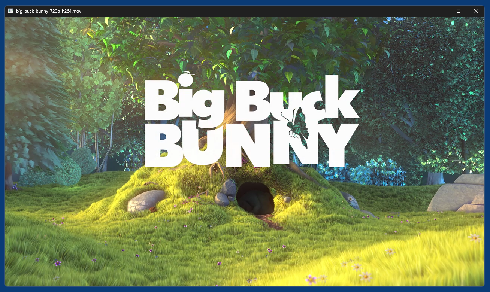
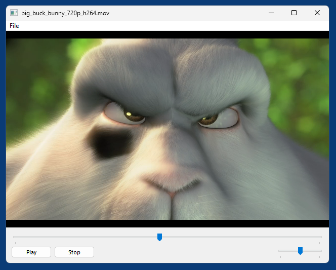

# python-mediafoundation (mfplayer)

`python-mediafoundation` is a simple Python package for Windows x64 that allows to quickly add Multimedia support to interactive GUI applications. Its core is a `Player` object that is initialized with the window handle (`HWND`) of some existing window/control and then renders video (if there is video, not just audio) into this window. The video is automatically resized whenever the size of this window changes.

Demos are provided for the following GUI toolkits:
- [PyQt5](demo_pyqt5.py) (easily portable to PyQt6 or PySide6)
- [Windows API](demo_winapi.py)
- [WinForms](demo_winforms.py) (Windows Forms, via [pythonnet](https://pypi.org/project/pythonnet/))
- [wxPython](demo_wxpython.py)  (wxWidgets)

## Usage

### Minimal code, standalone mode:
```
python -m mfplayer big_buck_bunny_720p_h264.mov
```
Or alternatively:
```python
from mfplayer.standalone import Main

main = Main()
main.load_file("big_buck_bunny_720p_h264.mov")
main.run()
```
*Result*  


### Player API

```python
__init__()
    hwnd: int,
    volume: float = .75,  # 0..1
    on_file_loaded: callable = None,
    on_end_reached: callable = None,
)

load_media_file(media_file: str) -> bool
close_file()

play()
pause()
stop()

skip_back(secs: float)
skip_forward(secs: float)
step_back(frames: int)
step_forward(frames: int)

get_duration() -> float seconds
get_metadata() -> dict
get_size() -> tuple(int, int)
get_time() -> float seconds
get_volume() -> float  # 0..1

get_audio_tracks() -> list
get_video_tracks() -> list

has_audio() -> bool
has_media() -> bool
has_video() -> bool

is_fullscreen() -> bool
is_playing() -> bool

scrub_start()
scrub_stop(seconds: float)

select_audio_track(track_id: int)
select_video_track(track_id: int)

set_brightness(value: float)  # -1..1, 0=default
set_contrast(value: float)  # -1..1, 0=default
set_fullscreen(fullscreen: bool)
set_hue(value: float)  # -1..1, 0=default
set_keep_aspect_ratio(keep: bool)
set_loop(bool)
set_saturation(value: float)  # -1..1, 0=default
set_time(seconds: float)
set_volume(float)  # [0..1]

take_snapshot(bmp_file: str)

# Listen for native Windows messages
register_message_callback(msg: int, callback: callable)
unregister_message_callback(msg: int, callback: callable = None)
```

## Demos

All demos implement basically the same application, a simple video player with the following features:
- Resizable window with menu bar
- Play/Pause and Stop buttons
- Position slider
- Volume slider
- Media files can be dropped from Explorer into the window
- Mouse click on video toggles play/pause state.
- Double-click on video toggles fullscreen mode.
- Menu File->Properties or Ctrl+I shows infos/metadata about the current media file

*PyQt5 demo*  


*Windows API demo*  

